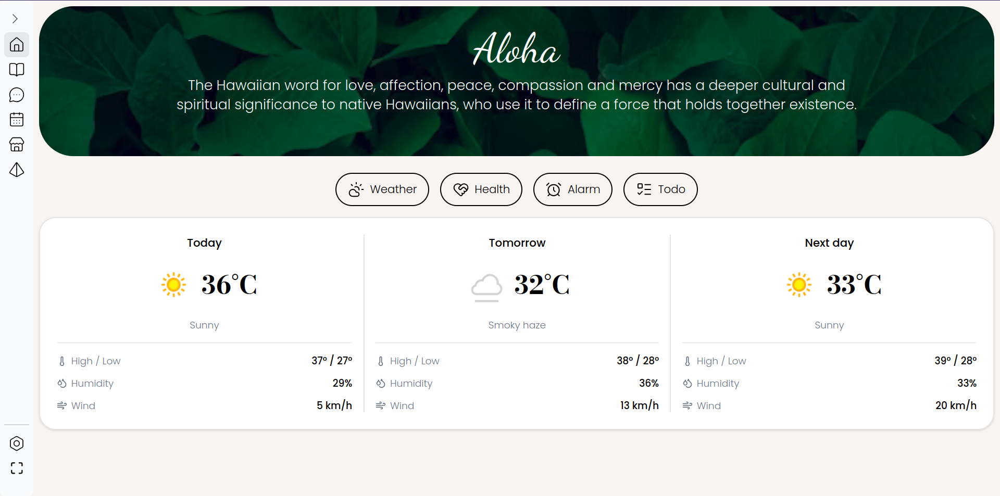
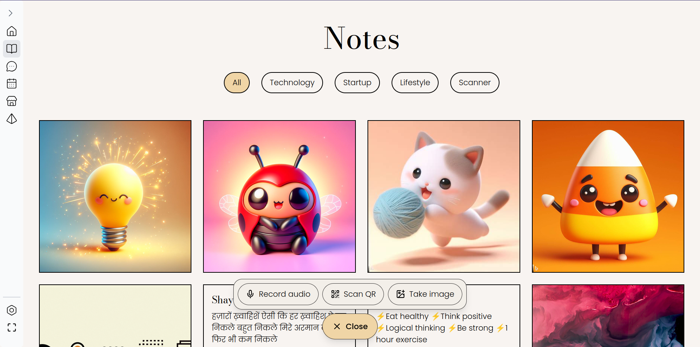
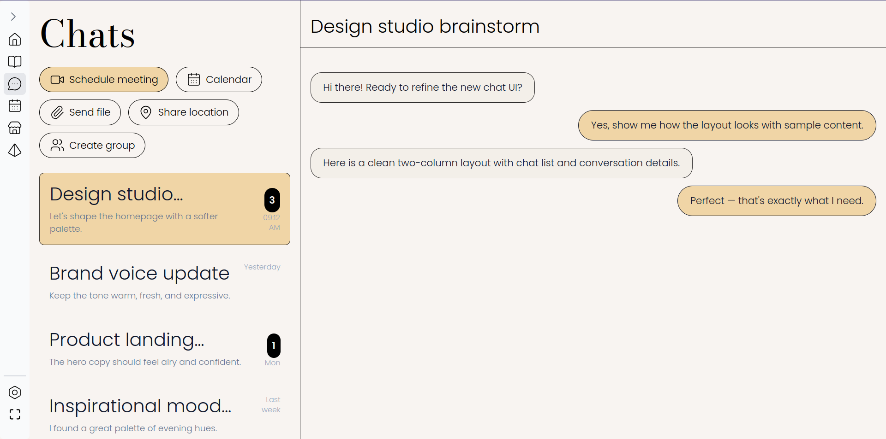
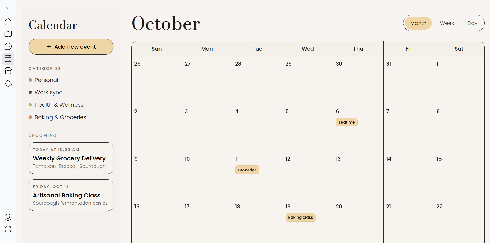
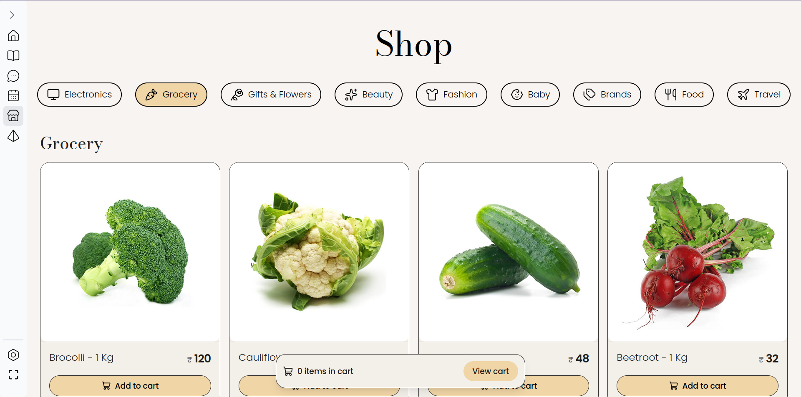
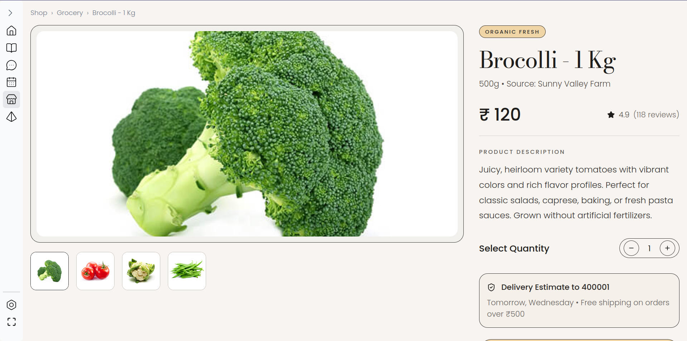
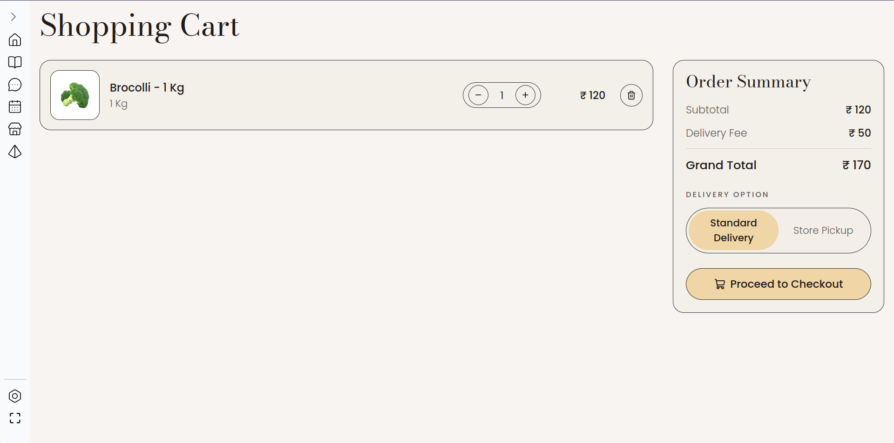
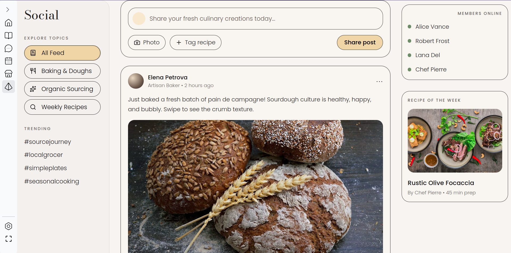

## Architecture

- **Aloha** (NestJS backend)
	- NestJS with Prisma ORM.
  	- Better Auth for authentication, integrated with NestJS using `@thallesp/nestjs-better-auth`.
  	- Supabase PostgreSQL for database storage.
  	- Supabase Storage for file and image storage.
  	- Environment variables managed through `@nestjs/config`.
		- DATABASE_URL=?
		- DIRECT_URL=?
		- SUPABASE_URL=?
		- SUPABASE_SECRET_KEY=?
		- BETTER_AUTH_SECRET=?
		- BETTER_AUTH_URL=http://localhost:3000
		- BACKEND_PORT=3000
		- FRONTEND_PORT=5173

- **Belle** (Web frontend)
	- Vite + React (TSX) app in `belle/`
	- Communicates with Aloha through its API.
	- Uses `VITE_`-prefixed environment variables.
		- VITE_FRONTEND_PORT=5173
		- VITE_BACKEND_PORT=3000

- **Milo** (Mobile application)
	- Built with Flutter.
  	- Communicates with Aloha through its API.

## TODO

- ✅Darkmode
- Notes CRUD
- ✅Why authenticated user can see the login register routes
- Update backend dependency
- ✅Integrate milo
- Prisma upgrade
- Authentication and Authorization. 
- Admin can control the user visible mini-apps. 
- ✅Email OTP login. 
- Replace screenshot with figma url
- Adaptive widgets
- Migrate to Bloc state management
- Explore single env use
- delete image should delete from storage also
- Build apk automatically on any changes in the milo

https://medium.com/@balajibal/super-apps-the-operating-system-of-everyday-life-38706471a94b
https://github.com/itsmbaqer/mini-programs-guidelines
 

## Run the project

Start frontend & backend (from repo root):

```bash
pnpm web
```

Start mobile:

```bash
adb connect <ip> && flutter run
```

Optional: Build a production APK and install it with one command

```bash
flutter build apk --release &&
adb install -r build/app/outputs/flutter-apk/app-release.apk
```

## Screenshots

Below are a few UI screenshots from the Belle frontend.

### Home


### Notes


### Chat


### Calendar


### Shop






### Social

